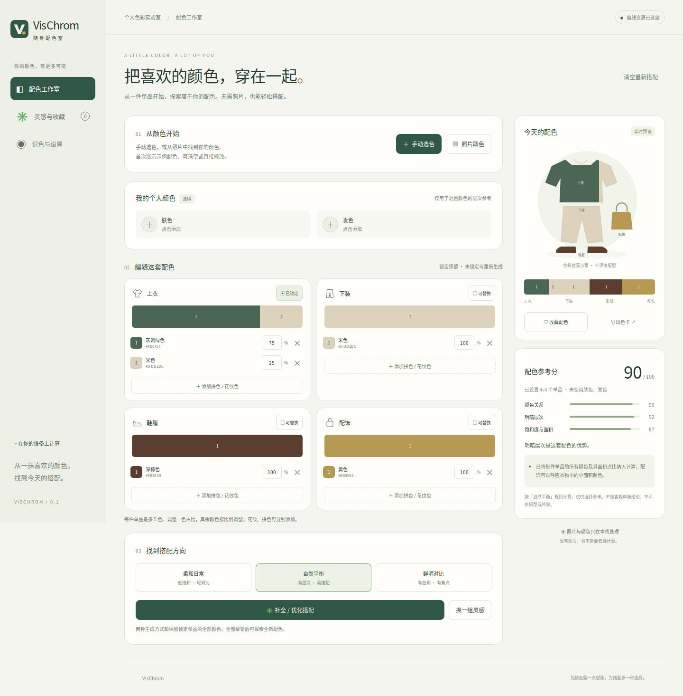

# VisChrom · 随身配色室

完全本地运行的穿搭**配色**助手。无需图片也能使用；每件衣物支持多个颜色与面积占比。只分析颜色关系，不评价版型、身材、面料或外貌。



## 已实现

- **可视化手动选色**：二维颜色面板、色相/饱和度/亮度滑块、常用色板、系统取色器、HEX 输入。
- **可选个人档案**：主动设置肤色和发色，未提供时不参与评分。
- **多色衣物**：上衣、下装、鞋履、配饰，每件最多 5 色；支持修改占比、移除颜色、合并重复颜色。
- **照片取色**：相册或拍照输入；拖动框选、点击局部或使用可键盘操作的区域滑块，提取 1–5 种颜色。照片只在内存处理，不上传、不持久化。
- **约束搭配**：锁定某个单品后，其全部颜色及占比保留；对剩余单品生成三个有区别的候选方案。
- **随机灵感**：柔和日常、自然平衡、鲜明对比三种风格。全部解锁可以生成全新组合。
- **配色参考分**：颜色关系、明暗层次、饱和度与面积、可选近脸层次；每次都提供解释。
- **识色辅助**：颜色名称、编号、可选纹理、红/绿色觉差异的近似易混淆提示。不会改变真实衣物颜色，也不承诺恢复色觉。
- **本地收藏与备份**：最多 30 套，JSON 导入导出、SVG 色卡导出。
- **离线 PWA**：资源缓存后可断网重新打开；没有服务端 API、CDN、在线字体或模型请求。
- **Android 工程**：将相同页面资源打包进 WebView，不申请 INTERNET 权限。原生相机/文件选择与文件保存桥接已提供，尚未实际构建和真机验证。

首屏包含可编辑的示例配色，并非根据用户照片生成。颜色名称是近似描述；色卡预览中的服装轮廓只用于展示颜色位置。

## 本地运行

需要 Node.js 18 或更新版本；应用与开发服务器均无 npm 运行依赖，无需 `npm install`。

```bash
npm start
```

打开 <http://127.0.0.1:4173>。界面显示“离线资源已就绪”后可断网测试。修改缓存资源时须递增 `public/sw.js` 中的缓存版本；开发时可在浏览器开发者工具清除 Service Worker 和缓存。

局域网预览可使用：

```bash
HOST=0.0.0.0 PORT=4173 npm start
```

手机浏览器打开电脑的局域网 IP。**普通局域网 HTTP 不支持 Service Worker 离线安装**，只适合联机预览；不要把手机上的 `localhost` 当成电脑地址。

### 在手机上使用

**PWA 路径**：通过可信 HTTPS 静态地址首次打开，等待离线资源缓存后添加到主屏幕。后续分析与离线启动不依赖服务器；首次分发资源仍需要可访问的静态地址。当前项目未发布任何托管站点。iOS 可通过 Safari 的“添加到主屏幕”使用；设备清理站点数据后需重新缓存。

**完全本地安装包路径**：构建下方 Android APK，所有资源随包安装，运行时不需要静态站点或后端服务。当前未提供已验证的 APK。

浏览器需支持 ES Modules、`dialog`、`structuredClone`、Canvas、Pointer Events。建议使用现代 Chrome / Safari 与更新后的 Android System WebView。实际相机入口、HEIC 解码和 PWA 安装界面因设备而异；读取失败可改用 JPG/PNG 或手动选色。

## Android 构建

构建环境：JDK 17、Gradle 8.11.1、Android SDK Platform 35、Build Tools 35.0.0。首轮构建需要下载构建工具与依赖；**应用运行不需要网络**。

```bash
# 配置本机 Android SDK，或在 android/local.properties 设置 sdk.dir。
export ANDROID_SDK_ROOT=/path/to/android-sdk
gradle -p android assembleDebug
```

输出：`android/app/build/outputs/apk/debug/app-debug.apk`。

也可以在 GitHub 的 Actions 手动运行 **Build Android APK (manual)**，下载 `VisChrom-debug-apk` 构建产物。此流程默认不会自动运行；发布前需签名与真机验收。

Android 工程通过 `WebViewAssetLoader` 从安装包映射本地 HTTPS origin；不联网。`allowBackup=false` 禁止系统自动云备份。相机借助系统拍照应用，不请求本应用的相机权限；临时照片位于缓存目录。选图使用系统文档选择器，导出由用户指定位置。

本次开发环境只有 Java 11，且没有 Android SDK / Gradle，所以尚未声称 Android 编译或真机测试通过。工程的最低系统 API 为 24，但仍需现代 WebView。

## 颜色算法与边界

照片解码并缩放到最长边 1200 像素；仅在用户指定区域取样，使用 OKLab 聚类。提取占比是**选区内像素占比**，不是整件衣服的实际面积，也不自动排除背景、反光或阴影。请手动确认区域和颜色。自动人体/衣物分割尚未实现。

多色衣物保存为独立颜色列表，不会简单平均成一种颜色。生成候选时使用柔和、平衡、对比模板；依据配色规则排序，再按颜色差异筛选不同方案。保留锁定单品，未锁定单品可替换为新的单色组合。

当前评分权重：

| 维度 | 有个人颜色时 | 无个人颜色时 |
| --- | ---: | ---: |
| 颜色关系 | 35% | 35/85 |
| 明暗层次 | 30% | 30/85 |
| 饱和度与面积 | 20% | 20/85 |
| 近脸颜色层次 | 15% | 不参与 |

近脸层次只在上衣与已设置的肤色/发色之间计算。每项均为启发式规则，不代表色彩科学中的审美定律。整体单品面积暂用固定系数（上衣 0.42、下装 0.36、鞋履 0.14、配饰 0.08）；每件单品内部按用户提供的颜色比例计算。少于两个有颜色的单品时不输出总分。不同风格和信息覆盖下的分数不可当作绝对排名。

识色参考使用线性 RGB 中的近似红/绿色觉模拟矩阵，再比较感知颜色距离。它不是用户色觉的精确模型，不可用于诊断。开启识色辅助不会改变配色分。真实红绿色觉障碍用户的可用性验证尚待进行。

## 测试

```bash
npm test
npm run check
```

端到端测试使用 Playwright，仅开发验证时需要安装：

```bash
npm install --no-save --package-lock=false playwright
npx playwright install chromium --only-shell
# 一个终端运行 npm start，另一个运行：
npm run test:browser
```

如已有 Playwright 或浏览器，可设置 `PLAYWRIGHT_MODULE`（包的绝对路径）与 `CHROMIUM_EXECUTABLE`。端到端测试输出放在 `artifacts/`，不提交个人备份文件。

已验证 14 项引擎测试及 Chromium 桌面/手机尺寸交互，包括红蓝合成图 75% / 25% 提取、手机区域选择、锁定多色不变、收藏刷新恢复、备份恢复和断网新标签页启动。尚未验证实体 Android/iOS 手机、原生系统相机、APK 构建、真实色觉障碍用户体验。

## 文件结构

```text
public/                   无依赖离线应用
  color-engine.js         纯函数颜色、评分、推荐、取色算法
  app.js                  交互、照片区域选择、本地存储
  index.html / styles.css  移动端与桌面界面
  sw.js                   离线资源缓存
android/                  Android 原生资源打包与文件桥接
scripts/serve.mjs          仅用于开发预览的静态服务器
tests/                    引擎测试与浏览器交互测试
docs/                     界面截图
```

开发进度与详细验证记录只保留在本地，不纳入 Git 仓库。

技术依据：[Service Worker 安全上下文](https://developer.mozilla.org/en-US/docs/Web/API/Service_Worker_API)、[Android 本地 WebView 内容](https://developer.android.com/develop/ui/views/layout/webapps/load-local-content)、[AGP 8.9 构建环境](https://developer.android.com/build/releases/agp-8-9-0-release-notes)、[W3C 不只依靠颜色传达信息](https://www.w3.org/WAI/WCAG22/Understanding/use-of-color.html)、[色觉模拟模型论文](https://pubmed.ncbi.nlm.nih.gov/19834201/)。
